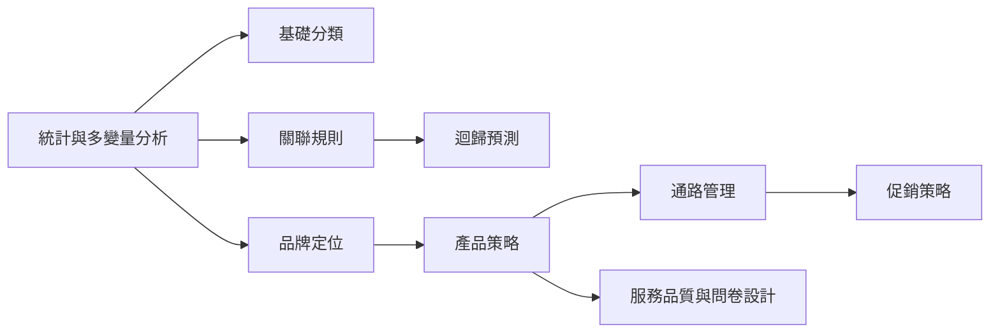

# 投影片教材 — 總覽與逐份索引

> **原始資料夾**：`投影片教材/`（9 份 PDF，共 462 頁）
> **授課**：王志軒 老師｜陽明交通大學工業工程與管理學系 電子化企業實驗室
> **逐份重點整理**：`doc/slides/`
> **全文原文**：`doc/_raw/slides/*.txt`（由 PDF 抽取）

## 一句話
本課程把**行銷理論**（定位、產品、通路、促銷、服務）與**資料分析方法**（分類、關聯規則、迴歸預測、統計與多變量）交織，作業則以 R 實作對應方法。

## 9 份投影片一覽

| 投影片 | 頁數 | 主題 | 主要方法 | 對應作業 | 整理檔 |
|--------|:---:|------|----------|----------|--------|
| `基礎分類.pdf` | 44 | 分類模型 | KNN、Naïve Bayes、羅吉斯迴歸、ROC | 與 HW2 題三（Pima）相連 | [slides/基礎分類.md](./slides/基礎分類.md) |
| `統計與多變量分析.pdf` | 65 | 統計檢定與多變量 | 卡方、F/t 檢定、ANOVA、迴歸、PCA、MDS | HW2 題一（bank.csv） | [slides/統計與多變量分析.md](./slides/統計與多變量分析.md) |
| `關聯規則.pdf` | 50 | 購物籃分析 | Apriori、FP-growth、Lift/Interest | HW2 題二、題三 | [slides/關聯規則.md](./slides/關聯規則.md) |
| `迴歸預測.pdf` | 54 | 時間序列＋正則化迴歸 | 移動平均、指數平滑、Holt-Winters、Ridge/Lasso、MARS | HW3 題三（NPV）延伸 | [slides/迴歸預測.md](./slides/迴歸預測.md) |
| `促銷策略.pdf` | 64 | 促銷與消費心理 | TAM、推薦系統、關聯規則、通膨工程經濟 | HW3 題三（現金流） | [slides/促銷策略.md](./slides/促銷策略.md) |
| `品牌定位.pdf` | 51 | 知覺圖/定位 | 因素分析、MDS、對應分析 CPA、PROFIT | HW3 題一（AHP）相連 | [slides/品牌定位.md](./slides/品牌定位.md) |
| `產品策略.pdf` | 60 | 產品開發 | 生命週期、TRIZ、DFM、QFD、Kano、Kansei | HW3 題三（多樣化） | [slides/產品策略.md](./slides/產品策略.md) |
| `通路管理.pdf` | 65 | 通路與決策 | 全通路、零售指標、AHP、TOPSIS | HW3 題一、題二 | [slides/通路管理.md](./slides/通路管理.md) |
| `服務品質與問卷設計.pdf` | 19 | 服務品質 | 品質成本、TQM、六標準差、Kano 模型 | HW2 題一/題四（問卷） | [slides/服務品質與問卷設計.md](./slides/服務品質與問卷設計.md) |

## 學習路徑建議

- **資料分析基礎**：先看 `統計與多變量分析`（檢定/迴歸/PCA）→ `基礎分類`（KNN/NBC/Logit）→ `關聯規則`（Apriori）→ `迴歸預測`（時間序列 + 正則化）。
- **行銷理論骨幹**：`品牌定位` → `產品策略` → `通路管理` → `促銷策略`，`服務品質與問卷設計` 支援前端的顧客需求調查。

## 頁碼對照說明

每個 `slides/*.md` 都有一張**逐頁索引表**，格式為：

| 頁 | 主題 |
|----|------|
| N | … |

- 表內「頁」即 PDF 的**實體頁序**（第 1 頁 = PDF 第一頁），與 `_raw/slides/*.txt` 的 `===== pN =====` 分段一致。
- 例外：`服務品質與問卷設計.pdf` 版面本身印有「5-1 ~ 5-19」，故該檔另標「檔內頁碼」。

## 快速用法

- 想知道某份投影片某頁在講什麼 → 開對應 `slides/*.md` 的逐頁索引表。
- 想看**原文全文**（非整理）→ 開 `_raw/slides/<同名>.txt`。
- 想知道投影片提到的資料集 → 每份 md 皆有「相關資料集」表格，可再對照 `資料檔清單.md`。
